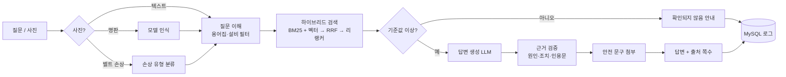

<div align="center">

# 🏭 Wanna Know — 현장 컨베이어 문제 해결 챗봇

**매뉴얼 PDF를 근거로, 컨베이어 장애 조치를 출처 쪽수와 함께 안내하는 RAG 챗봇**


[](https://github.com/WannaKnowHD/wanna_know/actions/workflows/main-branch-check.yml)

</div>

<!-- TODO: 시연 화면 캡처(로그인·채팅·관리자 대시보드)를 assets/ 에 넣고 여기에 연결 -->

## 목차

1. [주요 기능](#주요-기능)
2. [동작 구조](#동작-구조)
3. [빠른 시작](#빠른-시작)
4. [환경변수](#환경변수)
5. [평가 방법](#평가-방법)
6. [테스트](#테스트)
7. [폴더 구조](#폴더-구조)
8. [개발 규칙](#개발-규칙)
9. [문제 해결](#문제-해결)
10. [담당](#담당)

## 주요 기능

| 기능 | 설명 |
| --- | --- |
| 📖 **매뉴얼 근거 답변** | 증상을 말하면 원인·조치를 알려 주고, 답변마다 출처 문서와 쪽수를 붙입니다. |
| 🔎 **하이브리드 검색** | BM25와 벡터 검색을 합치고 리랭커로 다시 순위를 매겨 상위 5개를 근거로 씁니다. |
| 🛡️ **근거 검증** | LLM 답을 화면에 내보내기 전에 원인 ID·조치 개수·인용문이 검색된 자료와 맞는지 코드로 다시 확인합니다. |
| ⚠️ **안전 문구 자동 첨부** | 정비·조정 답변에는 `data/safety_rules.json`의 문구를 반드시 붙입니다. LLM이 만든 문구는 쓰지 않습니다. |
| 🙅 **모르면 모른다고 답변** | 매뉴얼에 없는 질문은 지어내지 않고 "확인되지 않음"으로 처리합니다. |
| 📷 **사진 입력** | 설비 명판으로 모델을 인식하고, 벨트 손상 사진은 손상 유형을 분류해 KB와 연결합니다. |
| 🧑‍💼 **로그인·대화 기록** | 사원번호 로그인, 사용자별 설비 필터·대화 기록(MySQL)을 지원합니다. |
| 📊 **관리자 대시보드** | 운영 현황, 답변 품질 검토, KB 현황(문서 추가), 시스템 상태 4개 탭을 제공합니다. |

## 동작 구조



| 구분 | 사용 기술 |
| --- | --- |
| 화면 | Gradio 6 (로그인 · 채팅 · 관리자 대시보드) |
| 생성·사진 인식·임베딩 | OpenAI API |
| 검색 | rank-bm25, ChromaDB, sentence-transformers(bge-reranker-v2-m3) |
| 문서 처리 | PyMuPDF, tiktoken |
| 저장소 | MySQL (Aiven) — 계정·세션·대화·로그·KB 공백·문서 목록 |

## 빠른 시작

### 준비물

- Python **3.11**
- OpenAI API 키
- MySQL(Aiven) 접속 정보와 CA 인증서(`certs/ca.pem`)
- 매뉴얼 PDF 3개 (저작권 때문에 저장소에 없습니다)

> `.env` 값, `ca.pem`, 매뉴얼 PDF는 팀 채널(드라이브)에서 공유받으세요. 모두 커밋 금지입니다.

### 1. 설치

```bash
git clone https://github.com/WannaKnowHD/wanna_know.git
cd wanna_know
python -m venv .venv
```

```bash
# macOS / Linux
source .venv/bin/activate
# Windows (PowerShell)
.venv\Scripts\Activate.ps1
```

```bash
pip install -r requirements.txt
```

### 2. 설정

```bash
cp .env.example .env      # Windows: copy .env.example .env
```

`.env`의 빈 값을 채우고 `certs/ca.pem`을 넣습니다. 항목 설명은 [환경변수](#환경변수)를 보세요.

```bash
python chatbot/core/config.py    # 설정이 모두 채워졌는지 확인 ([OK])
python scripts/test_db.py        # DB 접속 확인 (읽기만 함)
```

### 3. DB 준비

테이블을 만들고 계정과 데모 로그를 넣습니다. 여러 번 실행해도 안전합니다.

```bash
python scripts/seed.py              # 테이블 + 계정 + 데모 로그
python scripts/seed.py --no-demo    # 테이블 + 계정만
```

| 사원번호 | 역할 | 비밀번호 |
| --- | --- | --- |
| `A0001` | 관리자 | `.env`의 `SEED_ADMIN_PASSWORD` |
| `E0001` | 일반 사원 | `.env`의 `SEED_USER_PASSWORD` |
| `D0001` | 데모 사원 (데모 로그 전용) | `.env`의 `SEED_USER_PASSWORD` |

### 4. 색인 만들기

매뉴얼 PDF 3개를 `data/raw/initial/`에 넣습니다.

| 문서 | 파일 이름 |
| --- | --- |
| Hytrol 138 시리즈 | `hytrol_138acc_p1-27.pdf` |
| Fenner Dunlop 벨트 | `Fenner-Dunlop-Conveyor-Belt-Manual-21-39.pdf` |
| PRECO L 시리즈 | `preco_l_series_p6-29_54-60.pdf` |

```bash
python build_index.py    # KB·색인 전체 재생성 → chroma_db/ (OpenAI 임베딩 호출)
```

> `kb/`의 KB JSON은 저장소에 이미 들어 있습니다. 매뉴얼의 표 내용을 바꿨을 때만 `python scripts/build_kb.py`로 다시 만듭니다.

### 5. 실행

```bash
python app.py
```

브라우저에서 터미널에 표시된 주소(기본 http://127.0.0.1:7860)를 엽니다. 처음에는 리랭커 모델을 불러오느라 시작이 조금 걸립니다.

> 색인이 없거나 키가 틀리면 로그인·관리자 화면은 열리지만 질문에는 "사용할 수 없음" 안내만 나옵니다. 터미널의 `[app]` 로그에서 원인을 확인하세요.

### 명령 모음

모든 명령은 프로젝트 루트에서 실행합니다.

| 명령 | 하는 일 |
| --- | --- |
| `python app.py` | 챗봇 실행 |
| `python build_index.py` | KB·색인 전체 재생성 |
| `python scripts/build_kb.py` | 매뉴얼 표 → `kb/*.json` 재생성 |
| `python scripts/seed.py` | 테이블·계정·데모 로그 등록 |
| `python scripts/test_db.py` | DB 접속·테이블·계정 점검 |
| `python eval/run_eval.py` | 평가셋 자동 채점 |
| `pytest` | 단위 테스트 + 기능명세서 일치 확인 |

## 환경변수

`.env.example`을 복사해 `.env`로 저장합니다. 비밀값은 팀 채널에서 공유받습니다.

| 이름 | 용도 | 기본값·예시 |
| --- | --- | --- |
| `OPENAI_API_KEY` | OpenAI API 키 | 팀 공유 |
| `MODEL_TEXT` | 답변 생성 모델 | 팀 공유 |
| `MODEL_VISION` | 사진 인식 모델 | 팀 공유 |
| `EMBEDDING_MODEL` | 임베딩 모델 | `text-embedding-3-small` |
| `DB_HOST` · `DB_PORT` · `DB_USER` · `DB_PASSWORD` | MySQL 접속 정보 | 팀 공유 |
| `DB_NAME` | 붙을 데이터베이스 이름 (코드에는 DB 이름이 없음) | 연습용 `test` → 실제 DB 이름 |
| `DB_SSL_CA` | CA 인증서 경로 | `certs/ca.pem` |
| `BROWSER_STORAGE_KEY` | 로그인 세션 저장 키 | `cv_session` |
| `BROWSER_SECRET` | 세션 암호화 값. **고정값**이어야 서버를 다시 켜도 로그인이 유지됨 | 팀 공유 |
| `SESSION_HOURS` | 로그인 유지 시간 | `8` |
| `NOT_FOUND_THRESHOLD` | 이 점수 미만이면 "확인되지 않음" 처리 | `0.55` |
| `IMAGE_CONFIDENCE_THRESHOLD` | 사진 인식 확신도 기준 (미만이면 재촬영 요청) | `0.6` |
| `SEED_ADMIN_PASSWORD` · `SEED_USER_PASSWORD` | `seed.py`가 만들 계정 비밀번호 (8자 이상) | 직접 정함 |

> `DB_NAME=test`는 연습용입니다. 여기에 만든 계정·기록은 실제 DB로 옮겨지지 않습니다. 실제 DB로 바꾼 뒤에는 `python scripts/seed.py`를 다시 실행하세요.

## 평가 방법

`eval/`에 평가 데이터와 채점 스크립트가 있습니다.

| 데이터 | 문항 수 | 용도 |
| --- | --- | --- |
| `eval/testset.jsonl` | 100 (텍스트 + 사진) | 최종 평가. **튜닝에 쓰지 않습니다.** |
| `eval/devset.jsonl` | 17 | 검색 기준값 등 조정용 |
| `eval/images/` | 명판·벨트 손상·기타 사진 | 사진 문항과 사진 평가 |

### 실행

```bash
python eval/run_eval.py                                  # 평가셋 전체
python eval/run_eval.py --set dev                        # 개발셋
python eval/run_eval.py --version v2 --no-log            # 결과 파일 이름 지정, DB 로그 안 남김
python eval/run_eval.py --limit 5 --input text           # 앞 5문항, 텍스트만
```

| 옵션 | 설명 |
| --- | --- |
| `--set test\|dev` | 평가셋(기본) 또는 개발셋 |
| `--version` | 결과 파일 이름 앞부분 (예: `v0`, `v1`, 기본 `current`) |
| `--limit N` | 앞에서 N문항만 실행 |
| `--input all\|text\|photo` | 입력 종류 선택 |
| `--no-log` | DB `chat_logs`에 남기지 않음 |

| 스크립트 | 하는 일 |
| --- | --- |
| `eval/run_image_eval.py [--run] [--limit N] [--label ...]` | 사진 분류(명판·벨트 손상·기타) 평가 |
| `eval/run_nameplate_eval.py [--run] [--limit N]` | 명판 모델명 인식 정확도 평가 |
| `eval/search_report.py [--use-question]` | 리랭킹 전후 비교, 기준값 후보별 거절률 |
| `eval/try_search.py "질문" [--model L400]` | 질문 하나의 단계별 검색 상위 5개 확인 |

사진 평가 스크립트는 `--run`을 붙여야 실제로 API를 호출합니다. 붙이지 않으면 목록만 보여 줍니다.

### 결과 읽기

결과는 `eval/results/{버전}_{날짜시각}.csv`(지표 요약)와 `..._cases.csv`(문항별)로 저장됩니다.

| 지표 | 뜻 | 좋은 방향 |
| --- | --- | --- |
| `kb_top1` · `kb_recall@5` | 정답 KB가 1위 · 상위 5개 안에 든 비율 | 높을수록 |
| `cause_recall` · `cause_precision` | 정답 원인을 찾은 비율 · 답한 원인이 맞은 비율 | 높을수록 |
| `source_page` · `source_doc` | 출처 쪽 · 문서가 정답과 일치한 비율 | 높을수록 |
| `abstain_ok` | 매뉴얼에 없는 질문을 "확인되지 않음"으로 처리한 비율 | 높을수록 |
| `over_refusal_rate` | 답할 수 있는 질문을 거절한 비율 | **낮을수록** |
| `safety_included` | 안전 문구가 필요한 답변에 실제로 붙은 비율 | 높을수록 |
| `nameplate_ok` | 명판 사진에서 모델을 맞게 인식한 비율 | 높을수록 |

### 최근 결과 (v1, 평가셋 100문항, 2026-10-30)

| 지표 | 값 |
| --- | --- |
| KB 1위 / 상위 5개 | 77.6% (38/49) / 85.7% (42/49) |
| 원인 재현율 / 정밀도 | 66.4% / 94.3% |
| 출처 쪽 / 문서 일치 | 61.0% / 63.6% |
| 모르는 질문 거절 | 100% (17/17) |
| 과잉 거절률 | 31.3% (26/83) |
| 안전 문구 포함 | 100% (51/51) |
| 명판 인식 | 66.7% (4/6) |
| 응답 시간 평균 / p95 | 21.6초 / 32.4초 |

이전 실행(`v0`, `current` 등)은 `eval/results/`에서 비교할 수 있습니다.

## 테스트

```bash
pytest
```

- `tests/test_spec_conformance.py`: 코드가 기능명세서와 일치하는지 확인합니다. 명세서(`docs/기능명세서.xlsx`)는 저장소에 없으므로, 드라이브에서 받아 `docs/`에 넣어야 검사하고 없으면 건너뜁니다.
- `*_live_test.py`: 실제 API·DB가 필요해서 평소에는 건너뜁니다. 환경변수 `LIVE_RAG=1`(Git Bash: `LIVE_RAG=1 python -m pytest tests/pipeline_answer_live_test.py -v -s`)을 주면 실행됩니다.

## 폴더 구조

```
app.py · build_index.py        실행 파일
chatbot/
├─ pipeline.py                 질문 처리 파이프라인 (검색 → 생성 → 검증)
├─ ui/
│  ├─ gradio_app.py            화면 전환 (로그인 / 채팅 / 관리자)
│  ├─ login/                   로그인 화면
│  ├─ chat/                    채팅 화면 (사이드바·메시지·입력)
│  ├─ admin/                   관리자 탭 (운영 현황·답변 품질·KB 현황·시스템)
│  └─ dashboard.py             관리자 대시보드 조립
├─ rag/                        문서 처리·색인·검색·생성·검증·용어집
├─ vision/                     사진 처리 (명판·벨트 손상)
├─ core/                       설정, 로그인·세션, 대화 상태, 안전 문구, 로그, 공통 데이터 클래스
└─ db/                         MySQL 연결, 테이블 정의(schema.sql)
data/                          원본 PDF(커밋 안 함), 용어집·모델 목록·안전 규칙 등
kb/                            KbBuilder가 만든 KB JSON
chroma_db/                     벡터·BM25 색인 (커밋 안 함, build_index.py가 생성)
eval/                          평가 스크립트·평가셋·결과
scripts/                       seed.py · test_db.py · build_kb.py
tests/                         단위 테스트·명세서 일치 테스트
```

## 개발 규칙

- 사용자별 값(로그인 사원, 설비 필터, 대화 맥락)은 **전역 변수에 두지 않고** `gr.State`로 넘깁니다.
- 관리자 함수는 화면에서 숨겨도 API로 호출될 수 있으므로, **함수 안에서 `user.is_admin`을 확인**합니다.
- `.env`, `certs/`, `data/raw/`, `chroma_db/`는 커밋하지 않습니다.
- 기능명세서를 바꾸면 `docs/기능명세서.xlsx`와 `docs/기능명세서.md`를 함께 갱신하고 `pytest`로 확인합니다. (`docs/`는 저장소에 없고 각자 로컬에 둡니다.)
- WBS(진행 상태)는 구글 드라이브에서만 관리합니다. 저장소에는 두지 않습니다.

### 브랜치와 커밋

- 작업은 `feat/*` · `fix/*` · `docs/*` 브랜치에서 하고, **`dev`로 PR**을 보냅니다.
- `main`에는 `dev`만 병합할 수 있습니다. 다른 브랜치에서 PR을 보내면 CI(Main Branch Check)가 실패합니다.
- 커밋 메시지는 `feat:`, `fix:`, `chore:`, `docs:` 같은 접두어로 시작합니다.

## 문제 해결

| 증상 | 확인할 것 |
| --- | --- |
| 질문하면 "사용할 수 없음" 안내만 나온다 | 터미널의 `[app] 질문 처리 파이프라인을 만들지 못했습니다` 뒤 원인을 봅니다. 대개 `build_index.py`를 안 돌렸거나 `OPENAI_API_KEY`가 비어 있습니다. |
| 시작할 때 DB 오류로 멈춘다 | `python scripts/test_db.py`로 접속·SSL을 확인합니다. `certs/ca.pem`이 있는지, Aiven 서비스가 켜져 있는지 확인합니다. |
| 로그인이 서버를 껐다 켜면 풀린다 | `.env`의 `BROWSER_SECRET`이 비어 있거나 바뀌었습니다. 고정값으로 두세요. |
| 첫 질문이 느리다 | 리랭커 모델을 불러오는 시간입니다. 앱은 시작할 때 미리 불러옵니다. 첫 실행은 모델 다운로드로 더 걸립니다. |
| 답변이 자꾸 "확인되지 않음"이다 | `NOT_FOUND_THRESHOLD`가 높지 않은지, 설비 필터가 질문과 맞는지 확인합니다. `python eval/try_search.py "질문"`으로 검색 결과를 볼 수 있습니다. |
| 연습용 DB(`test`)에 붙었다는 경고가 나온다 | `.env`의 `DB_NAME`을 실제 DB 이름으로 바꾸고 `python scripts/seed.py`를 다시 실행합니다. |

## 담당

| 영역 | 파일 | 담당 |
| --- | --- | --- |
| 화면 | chatbot/ui/ | |
| 문서 처리·색인 | chatbot/rag/document_processor.py, build_index.py | |
| 검색 | chatbot/rag/retriever.py, glossary.py | |
| 생성·검증 | chatbot/pipeline.py, rag/llm.py, rag/validator.py, core/safety.py | |
| 사진 | chatbot/vision/ | |
| 로그인·DB | chatbot/core/auth.py, state.py, logger.py, chatbot/db/ | |
| 평가·대시보드 | eval/, chatbot/ui/dashboard.py | |

## 참고

- 매뉴얼 PDF(Hytrol, Fenner Dunlop, PRECO)의 저작권은 각 제조사에 있으며 저장소에 포함하지 않습니다.
- 시연용 모듈러 벨트 문서(`mb200`)는 관리자 화면의 "KB 현황"에서 PDF를 추가하는 시연에 씁니다.
